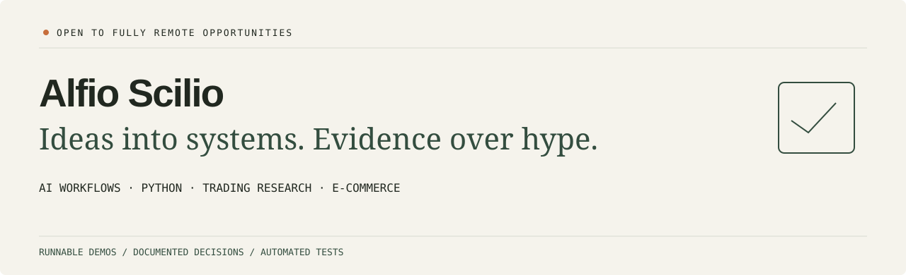

<picture>
  <source media="(prefers-color-scheme: dark)" srcset="assets/banner-dark.svg">
  <source media="(prefers-color-scheme: light)" srcset="assets/banner-light.svg">
  
</picture>

  <a href="https://scil95-dotcom.github.io/"><strong>Explore the portfolio</strong></a> ·
  <a href="https://www.linkedin.com/in/alfio-scilio-9157a1238/">LinkedIn</a> ·
  <a href="mailto:scilioalfio95@gmail.com">Email</a> ·
  <a href="tel:+393457060820">+39 345 706 0820</a>

## Hi, I'm Alfio

I'm exploring practical **AI-assisted automation, Python tooling and digital operations**, and I'm open to **fully remote opportunities**. My personal projects turn broad ideas into small workflows that a reviewer can run, test and understand.

The themes: **structured AI outputs, reliable data, trading systems engineering and e-commerce operations**.

## Selected work

| Project | What you can inspect | Start here |
| --- | --- | --- |
| **[CSV Quality Pipeline](https://github.com/scil95-dotcom/csv-quality-pipeline)** | Exact schemas, decimal amounts, explicit rejection reasons and reproducible HTML reports. | [Quick start](https://github.com/scil95-dotcom/csv-quality-pipeline#try-it-in-one-minute) |
| **[LLM Workflow Lab](https://github.com/scil95-dotcom/llm-workflow-lab)** | Versioned prompts, structured outputs, bounded retries, review gates and an optional local Ollama adapter. | [Source & evaluation](https://github.com/scil95-dotcom/llm-workflow-lab) |
| **[Trading Replay Lab](https://github.com/scil95-dotcom/trading-replay-lab)** | Offline paper execution, fees, slippage, risk limits and a traceable synthetic replay. | [Source & controls](https://github.com/scil95-dotcom/trading-replay-lab) |
| **[E-commerce Ops Lab](https://github.com/scil95-dotcom/ecommerce-ops-lab)** | Idempotent order events, stock reservations, oversell prevention and visible fulfillment exceptions. | [Source & event model](https://github.com/scil95-dotcom/ecommerce-ops-lab) |
| **[Portfolio website](https://github.com/scil95-dotcom/scil95-dotcom.github.io)** | Responsive UI, keyboard-operated tabs, reduced-motion support and a printable project brief. | [Live website](https://scil95-dotcom.github.io/) |

## Practices reflected in the repositories

- **Make inputs explicit:** schemas, assumptions, boundaries and failure reasons.
- **Test failure cases:** malformed JSON, duplicate events, bad data and operational limits.
- **Keep review reproducible:** synthetic fixtures, clear CLI commands and automated checks.
- **Document the handoff:** quick starts, architecture notes and tradeoffs for async review.

**Technologies represented:** Python · Git / GitHub · JSON / CSV · Prompt engineering · Local AI / Ollama · Automated tests · HTML / CSS / JavaScript. Existing private projects also explore Next.js, React, TypeScript and Supabase.

## Project context & transparency

The public labs are new personal portfolio demos, developed with **AI assistance** and verified with automated checks. They use **synthetic data** for engineering review. Workflow fixture checks and paper simulation should be interpreted within their documented scope. Private operational experiments remain stopped; their source and working data are excluded from the public portfolio.

## Let's connect

**Interested in a fully remote role or a project conversation:**

[scilioalfio95@gmail.com](mailto:scilioalfio95@gmail.com) · [+39 345 706 0820](tel:+393457060820) · [LinkedIn](https://www.linkedin.com/in/alfio-scilio-9157a1238/) · [Portfolio PDF](https://scil95-dotcom.github.io/alfio-scilio-portfolio.pdf)
